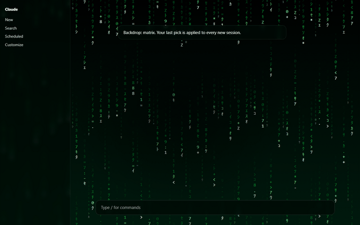
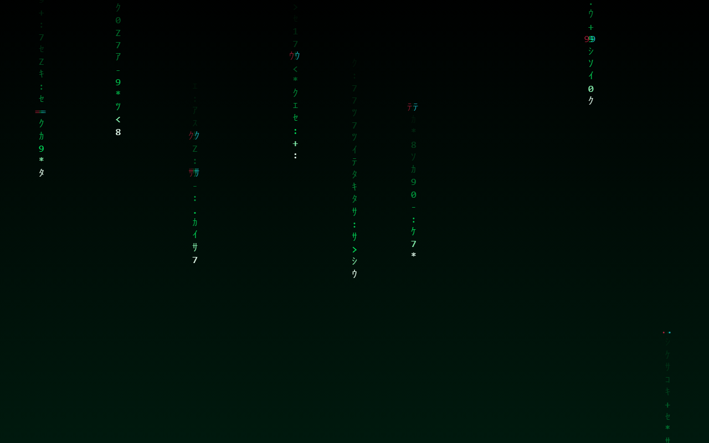
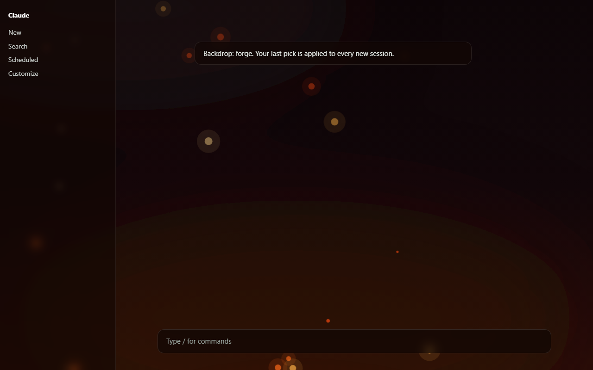
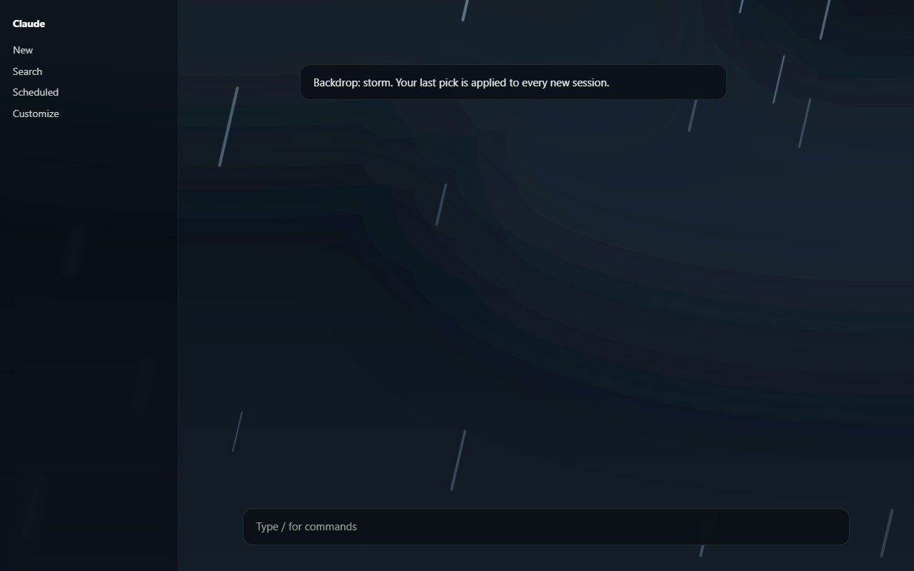
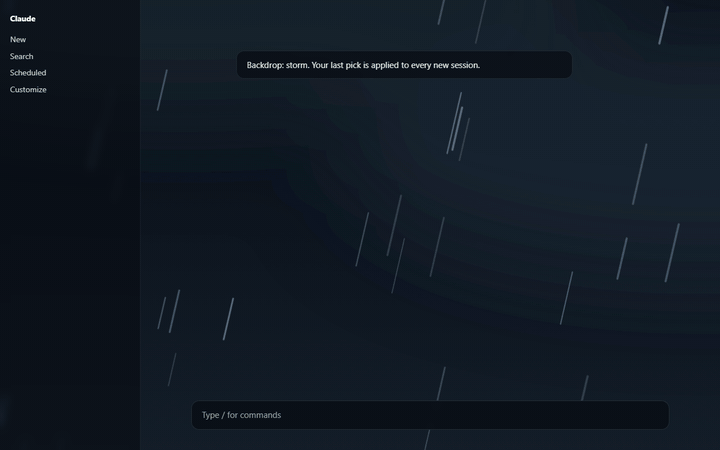

<h1 align="center">Matrix Backdrop</h1>
<p align="center">Animated backdrops for the Claude desktop app.<br>Pick one, and it comes back on every new session.</p>

<p align="center"></p>

## Backdrops

| | |
| :-- | :-- |
| **matrix**<br>Falling green code<br>`/backdrop matrix` | **forge**<br>Embers and heat<br>`/backdrop forge` |
|  |  |
| **storm**<br>Rain and clouds<br>`/backdrop storm` | **night-sky**<br>Stars and shooting stars<br>`/backdrop night-sky` |
|  |  |

<details>
<summary>Animated previews of the other three</summary>
<br>
  
</details>

> Previews are rendered from the mod's own scenes in a mock window, not screenshots of the app.

## Install

**Desktop app** (where `/plugin` does not run): click **+** next to the prompt box, then **Plugins**, **Add marketplace** with `hzqdev30/claude-bd-matrix`, then **Add plugin**.

**Terminal session:**

```
/plugin install backdrops --marketplace hzqdev30/claude-bd-matrix
```

**Shell:**

```bash
claude plugin install backdrops --marketplace hzqdev30/claude-bd-matrix
```

## Commands

| Command | Does |
| :-- | :-- |
| `/backdrop <name>` | Switch to `forge`, `matrix`, `storm` or `night-sky` |
| `/backdrop next` | Cycle to the next one |
| `/backdrop list` | List the backdrops |
| `/backdrop off` | Remove the backdrop. New sessions stay off until you pick again |

## Customize

The matrix backdrop has two settings:

| Setting | What it does | Choices | Default |
| :-- | :-- | :-- | :-- |
| **Change interval** (`changeEvery`) | How often a changing character swaps to a new one | `1s` `2s` `3s` `5s` `10s` | `2s` |
| **Share that changes** (`changeShare`) | How much of the bright code keeps changing: low is calm, high is busy | `5%` `10%` `20%` `35%` `50%` `75%` | `20%` |

Set them on the screen shown while you install the plugin. To change them later, use the plugin's settings row (`/config` in a terminal session). The values are stored under `pluginConfigs` in your `settings.json`, and a change reloads the mod.

Changes apply the next time the matrix backdrop is drawn, so run `/backdrop matrix` once after a change to see it.

Characters swap on a 0.5 second grid, so the shortest interval is 1s. Only the bright front columns change. The dim back columns stay still, which is why `20%` moves roughly one in ten of all characters on screen.

## Notes

- Your last pick is saved and applied at the start of every new session.
- Backdrops draw on the desktop and mobile apps only, not in a plain terminal.
- Moving scenes redraw twice a second. Rain, embers and stars use CSS animation and respect reduced-motion settings.
