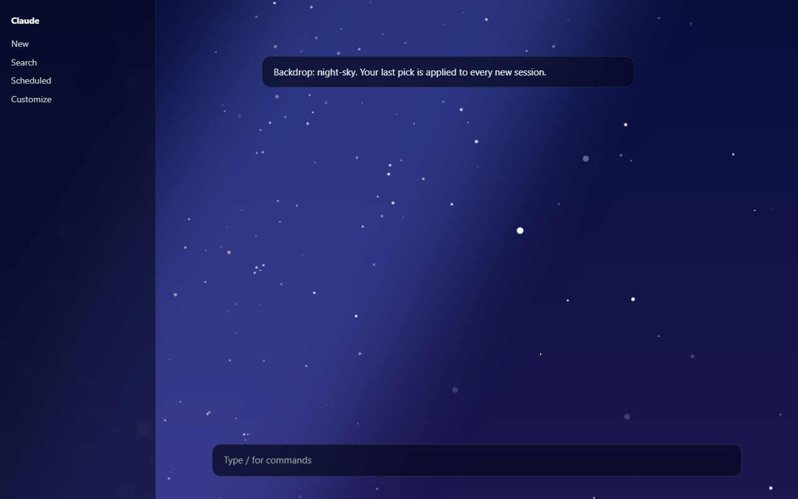
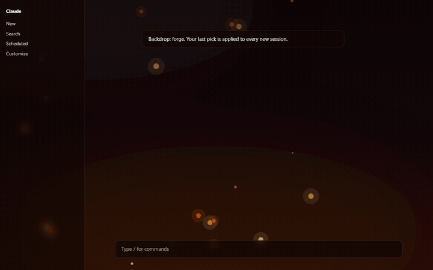
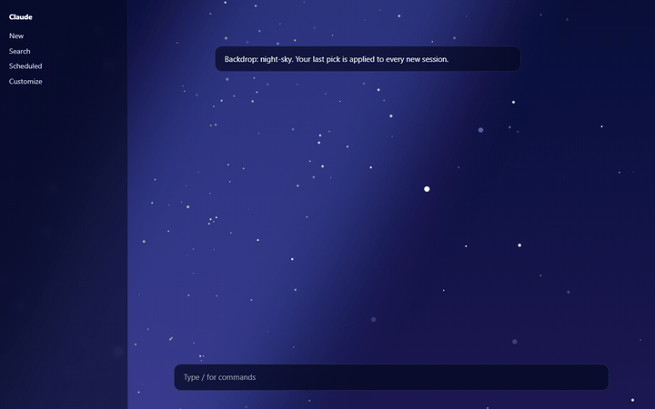

<h1 align="center">Matrix Backdrop</h1>
<p align="center">Animated backdrops for the Claude desktop app.<br>Pick one, and it comes back on every new session.</p>

<p align="center"></p>

## Backdrops

| | |
| :-- | :-- |
| **matrix**<br>Falling green code<br>`/backdrop matrix` | **forge**<br>Embers and heat<br>`/backdrop forge` |
|  |  |
| **storm**<br>Rain and clouds<br>`/backdrop storm` | **night-sky**<br>Stars and shooting stars<br>`/backdrop night-sky` |
|  |  |

<details>
<summary>Animated previews of the other three</summary>
<br>
  
</details>

> Previews are rendered from the mod's own scenes, not screenshots of the app.

## Install

**Desktop app** (where `/plugin` does not run): click **+** next to the prompt box, then **Plugins**, **Add marketplace** with `hzqdev30/claude-bd-matrix`, then **Add plugin**.

**Terminal session:**

```
/plugin install backdrops --marketplace hzqdev30/claude-bd-matrix
```

**Shell:**

```bash
claude plugin install backdrops --marketplace hzqdev30/claude-bd-matrix
```

## Commands

| Command | Does |
| :-- | :-- |
| `/backdrop <name>` | Switch to `forge`, `matrix`, `storm` or `night-sky` |
| `/backdrop next` | Cycle to the next one |
| `/backdrop list` | List the backdrops |
| `/backdrop off` | Remove the backdrop. New sessions stay off until you pick again |

## Customize

The matrix backdrop has four settings:

| Setting | What it does | Choices | Default |
| :-- | :-- | :-- | :-- |
| **Streams** (`density`) | How many streams of code fall on each of the left, centre and right | `sparse` (2) `normal` (3) `dense` (4) | `normal` |
| **Change interval** (`changeEvery`) | How long a changing character shows each glyph before it swaps | `1s` `2s` `3s` `5s` `10s` | `2s` |
| **Share that changes** (`changeShare`) | How much of each stream keeps changing: low is calm, high is busy | `5%` `10%` `20%` `35%` `50%` `75%` | `20%` |
| **Glitch** (`glitch`) | A red and cyan ghost flashes on a character as it swaps | `off` `low` `medium` `high` | `medium` |

Set them on the screen shown while you install the plugin. To change them later, use the plugin's settings row (`/config` in a terminal session). The values are stored under `pluginConfigs` in your `settings.json`, and a change reloads the mod.

After a change, switch away and back to see it: run `/backdrop forge`, then `/backdrop matrix`. Re-selecting the backdrop you are already on may keep showing the old picture.

Glitch strength: `low` is a 3 px ghost for 0.4 s, `medium` is 5 px for 0.6 s and `high` is 8 px for 0.9 s. The glitch only touches characters that are swapping.

## Notes

- Your last pick is saved and applied at the start of every new session.
- Backdrops draw on the desktop and mobile apps only, not in a plain terminal.
- Every backdrop animates itself with CSS, so the mod never redraws the picture. That keeps motion smooth and the load low.
- An Svg picture may hold at most 131,072 characters. The default matrix is about 50,000.
